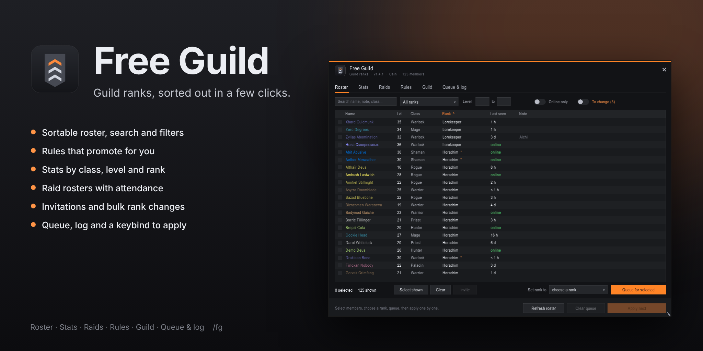
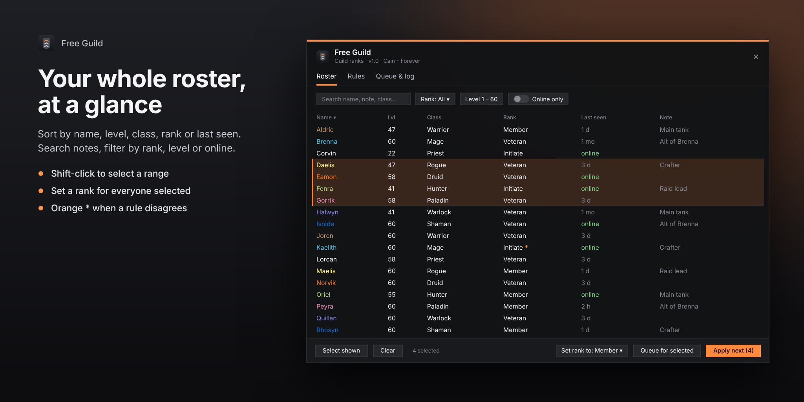
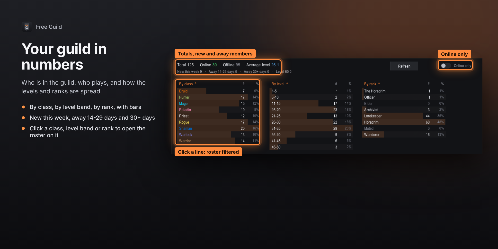
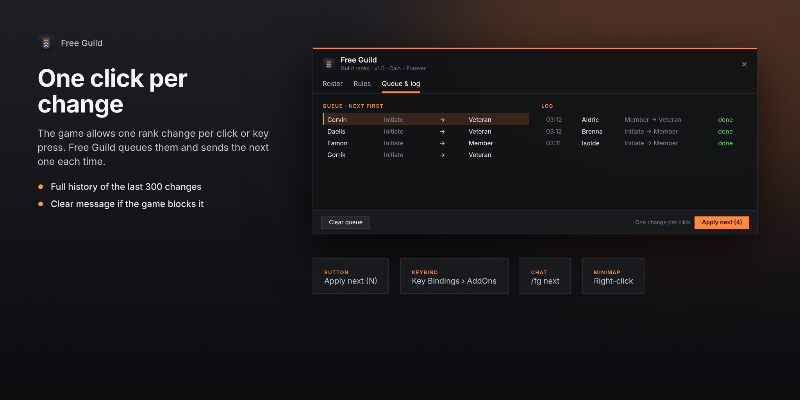

<h1 align="center">Free Guild</h1>

Guild roster and rank tool for guild masters and officers: filters, bulk ranks, rules that promote for you, guild info and notes.

<a href="https://www.curseforge.com/wow/addons/freeguild"><b>Download on CurseForge</b></a> · version <b>1.4.2</b> · WoW Forever (1.60.1) · <code>/fg</code>

## Screenshots

<table>
<tr>
<td width="50%" valign="top"> <b>Your whole roster, at a glance</b> Sort, search, filter, select many members at once.</td>
<td width="50%" valign="top"> <b>Rules that promote for you</b> Level, class, seniority, last online, notes… mapped to ranks.</td>
</tr>
<tr>
<td width="50%" valign="top"> <b>One click per change</b> The game allows one rank change per click; Free Guild queues them for you.</td>
</tr>
</table>

Rank management for guild masters and officers on WoW Forever.

## Roster

- Sortable list: name, level, class, rank, last online, note. Search by name, note or class; filter by rank, level range and online.
- Select many members (click, Shift-click for a range, "Select shown"), choose a rank, queue the changes.
- An orange `*` shows members whose rank does not match your rules. The **To change** filter lists only the members your rules would really move, and queues them all in one click.
- **Invite** sends a group invitation to the selected members who are online (the group becomes a raid when needed).

## Rules

- Up to 8 rules, first match wins. Each rule can combine: **level range**, **class**, **current rank**, **member since** (days), **offline for** (days), and text in the **public or officer note**.
- Rules never touch protected ranks, and only promote unless you allow demotions.
- Reminder at login when someone should get a new rank. Export / import your rules.
- The game does not tell when a member joined: Free Guild remembers the first day it saw each member and counts from there.

## Stats

- Total, online, offline, average level, new members this week, members away for 14-29 and 30+ days, level 60s.
- Members by class, by level band and by rank, with counts, percentages and bars. Click a line to open the roster filtered on it.
- "Online only" switch to count only the members who are online.

## Raids

- Several raid rosters per guild: main or bench, role (tank, healer, DPS), excused for the next raid.
- **Invite roster** invites the main roster members who are online (Shift-click: the bench too).
- **Take attendance** records who is in your group: present, absent, excused or bench. Attendance % and the last 12 raids for each member.

## Applying changes

The game only allows **one rank change per click or key press**. Free Guild queues the changes and sends the next one each time you press **Apply next** or its key binding (Key Bindings › AddOns › Free Guild). No need to refresh the roster between clicks; changes that did not go through are queued again.

## Guild tab

- Message of the day and guild information: read and edit. When the game keeps an edit to its own window, Free Guild uses the game's `/gmotd` command or gives you the text to paste there.
- Public and officer notes of the selected member.
- Last known guild bank money, with the date it was seen.

## Queue & log

The changes waiting to be sent, and the last 300 actions.

## Commands

- `/fg` — open the window
- `/fg next` — show the next queued change

## Free Hub

Free Guild works on its own. With **Free Hub** installed, its options open inside the hub next to the other Free addons, and a single minimap button replaces theirs.

## Notes

- Built for WoW Forever. Rank changes use the game's own `/gpromote` and `/gdemote` commands, one step per click.
- What you can change depends on your guild rank permissions.
- Bug reports and ideas are welcome in the comments.

## The Free suite

Addons for WoW Forever that share the same look, profiles and a single minimap button through Free Hub.

| | Addon | |
|---|---|---|
|  | **[Free Hub](https://github.com/DecardCainSuite/FreeHub)** — All the Free addons in one window: options side by side, product pages with gallery, and a single minimap button. | [CurseForge](https://www.curseforge.com/wow/addons/free-hub) |
|  | **[Free Unit Frames](https://github.com/DecardCainSuite/FreeUnitFrames)** — Fully customisable unit frames for player, target, focus, party, raid and bosses, with an ElvUI-style preset in one click. | [CurseForge](https://www.curseforge.com/wow/addons/freeunitframes) |
|  | **[Free Bars](https://github.com/DecardCainSuite/FreeBars)** — Up to 9 action bars, laid out as a grid or an arc, with mouseover fade, paging and a clean flat look. | [CurseForge](https://www.curseforge.com/wow/addons/freebars) |
|  | **[Free Swing](https://github.com/DecardCainSuite/FreeSwing)** — Swing timers for main hand, off hand and ranged, at exactly the size and style you want. | [CurseForge](https://www.curseforge.com/wow/addons/freeswing) |
|  | **[Free Minimap](https://github.com/DecardCainSuite/FreeMinimap)** — A rectangular minimap of any size, with a region map drawn from the game's own terrain tiles around you. | [CurseForge](https://www.curseforge.com/wow/addons/freeminimap) |
|  | **[Free Guild](https://github.com/DecardCainSuite/FreeGuild)** (this one) — Guild roster and rank tool for guild masters and officers: filters, bulk ranks, rules that promote for you, guild info and notes. | [CurseForge](https://www.curseforge.com/wow/addons/freeguild) |
|  | **[Free LFG](https://github.com/DecardCainSuite/FreeLFG)** — The group finder as a compact, sortable table: leader, roles, free slots, one-click whisper from a template, and live filters you write yourself. | [CurseForge](https://www.curseforge.com/wow/addons/freelfg) |

## Changelog

What is new in the current version: [CHANGELOG.md](CHANGELOG.md). Full history: [CHANGELOG-history.md](CHANGELOG-history.md).

## Repository layout and releases

- The repository root is the addon folder (`FreeGuild/`), as installed in `Interface\AddOns`.
- `curseforge/` holds the CurseForge page: `description.md` (fields, gallery captions, description) and `images/` (logo, gallery, social preview). It is not shipped in the addon zip.
- `CHANGELOG.md` holds the notes of the version being prepared; they are sent to CurseForge as the file's changelog.
- Releasing: bump `## Version` in `FreeGuild.toc`, write `CHANGELOG.md`, then publish a GitHub release named `v<version>`. GitHub Actions packages the addon with the [BigWigs packager](https://github.com/BigWigsMods/packager) and uploads it to CurseForge and to the GitHub release.

Bug reports and ideas are welcome in the issues or in the CurseForge comments.
